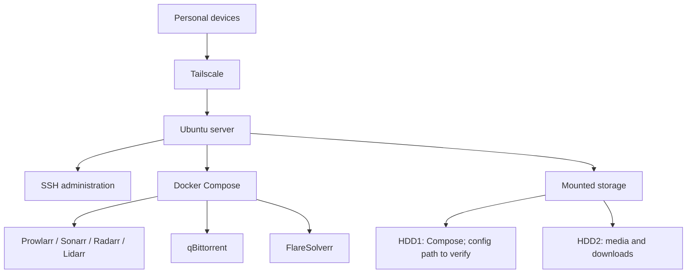

# Homebase

**My self-hosted homelab for media, storage and remote access.**

Built and maintained by [Ankur Ashish Saxena](https://github.com/anksax), a Robotics & Automation undergraduate. This project documents my server rebuild, the services I used, and the troubleshooting involved in getting them working together.

The project brings Linux administration, Docker Compose, persistent storage and private remote access into one practical homelab.

> Documentation baseline: my July 2026 rebuild. Prepared on 8 October 2026 from recorded setup notes. The live server has not been inspected for this repository; current versions and service status still need confirmation.

## What the server does

- Stores books, music, movies, TV and downloads on a dedicated mounted drive.
- Runs Prowlarr, Sonarr, Radarr, Lidarr, qBittorrent and FlareSolverr with Docker.
- Provides remote access through Tailscale and SSH.
- Has previously hosted Jellyfin, Navidrome, Jellyseerr, Portainer and Homarr/Homepage.
- Documents a related Android–Windows music sync setup using Syncthing; server participation is unconfirmed.

## Recorded setup

| Component | Recorded configuration |
| --- | --- |
| Operating system | Ubuntu 24.04.4 LTS, as reported during the rebuild |
| Deployment | Docker Compose |
| Compose directory | `/mnt/hdd1/compose` |
| Storage mount points | `/mnt/hdd1`, `/mnt/hdd2` |
| Media/data folders | `books`, `downloads`, `movies`, `music`, `tv` on HDD2 |
| Remote connectivity | Tailscale |
| Administration | SSH |
| Current hardware | HP Pavilion Gaming laptop; CPU and RAM to be confirmed |
| Current storage | 1.8 TB HDD and 128 GB SSD, as reported by the owner |

## Architecture

Logical layout based on the recorded setup. Service integrations and each container's actual mounts must be checked against the live configuration.

## Documentation

| Guide | Contents |
| --- | --- |
| [Project overview](docs/01-overview.md) | Goals, background, timeline and known gaps |
| [Storage](docs/02-storage.md) | Mount points, folder layout and path verification |
| [Docker services](docs/03-services.md) | Recorded ports, responsibilities and integration checks |
| [Networking](docs/04-networking.md) | Tailscale, SSH and Docker networking |
| [Troubleshooting](docs/05-troubleshooting.md) | Issues encountered and what resolved them |
| [Operations and recovery](docs/06-operations.md) | Routine checks, backup and rebuild workflow |
| [Music sync](docs/07-music-sync.md) | Related Android–Windows sync setup |
| [Complete the documentation](docs/08-completion.md) | Evidence to collect and GitHub upload steps |
| [Hardware history](docs/09-hardware.md) | Current Pavilion specifications and earlier setup photo |
| [Server inventory](docs/inventory-template.md) | Editable current-state record |

## Hardware and setup photos

I have since moved the server to an **HP Pavilion Gaming laptop with a 1.8 TB HDD and a 128 GB SSD**. Exact model, CPU, RAM and the new disk-to-mount mapping still need to be recorded. The photos below document my earlier setup and its remote-access configuration.

> **Warning: do not copy the powered-on, open-laptop setup shown below.** The laptop was running with its bottom cover removed in this photo. Shut down the laptop, unplug the charger, and follow the exact model's service manual, including battery disconnection before handling internal components. Refit the cover before normal operation. This image records my personal setup, not a recommended way to run a server.

*Earlier hardware setup; the laptop was powered on when photographed, as confirmed by me.*

*Supplied Tailscale screenshot showing Linux and Windows devices connected. This is historical evidence, not a live status check.*

See [hardware history](docs/09-hardware.md) for the upgrade and outstanding details.

## Lessons learned

Persistent host paths matter as much as the containers. A missing configuration directory interrupted Prowlarr setup, and a malformed FlareSolverr address prevented the integration from working. Docker access, service authentication and data paths each needed separate checks.

A future rebuild should preserve verified configuration and restore storage before starting applications.

## Next improvements

- [ ] Confirm exact Pavilion Gaming model, CPU, RAM, Ubuntu version and running services.
- [ ] Add a reviewed, redacted copy of the actual Compose configuration.
- [ ] Document exact host-to-container path mappings.
- [ ] Add screenshots showing service health and the storage layout.
- [ ] Record an actual backup destination and successful restore test.
- [ ] Confirm which earlier media players and dashboards are installed now.

## Profiles

[GitHub](https://github.com/anksax) · [LinkedIn](https://www.linkedin.com/in/ankur-ashish-saxena/)
